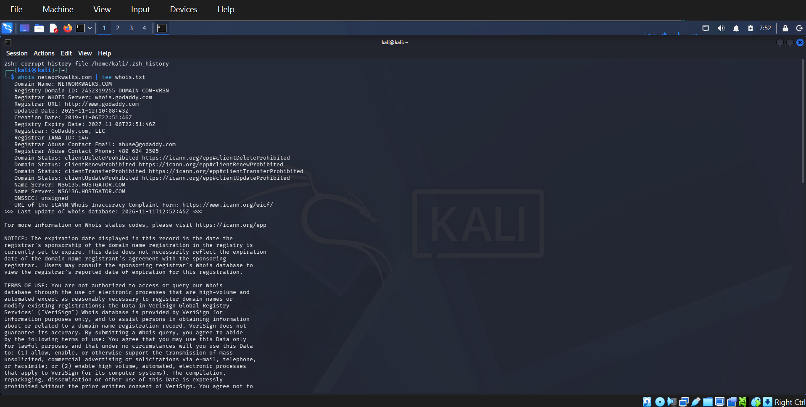
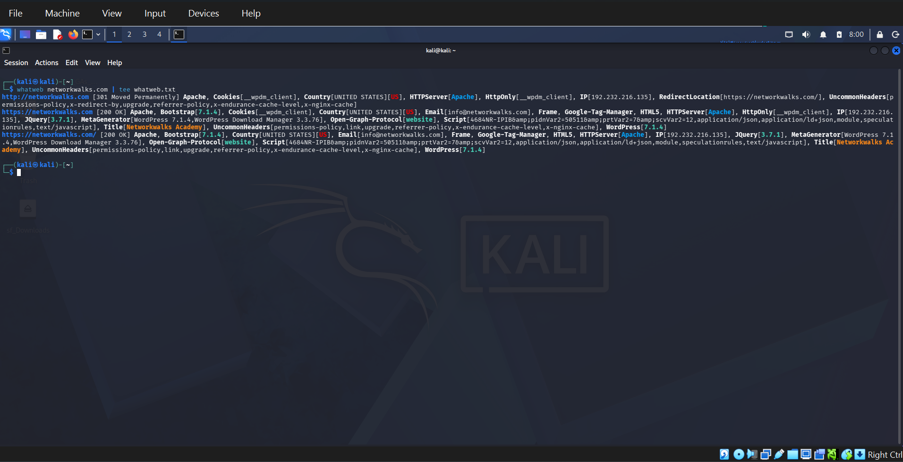
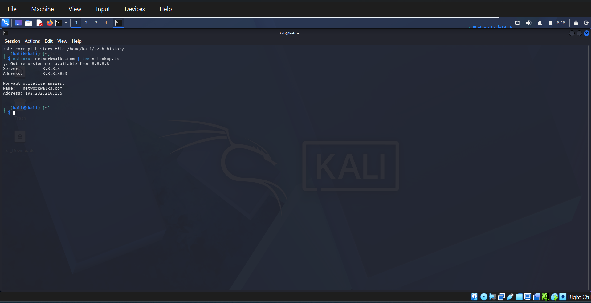
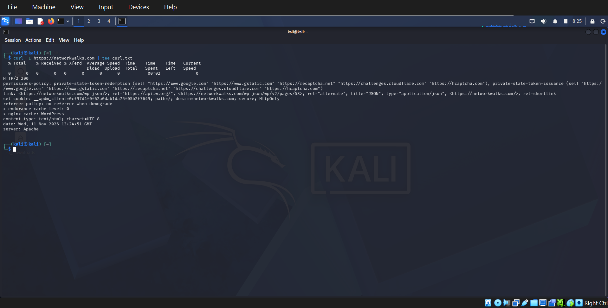
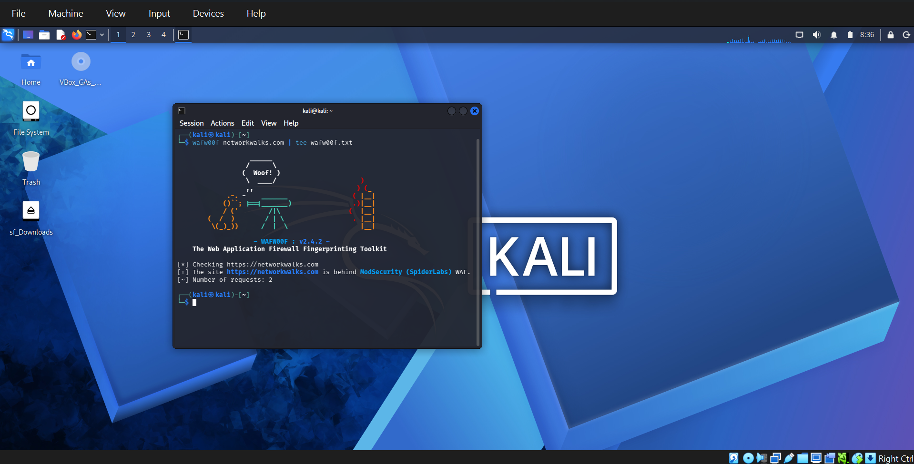
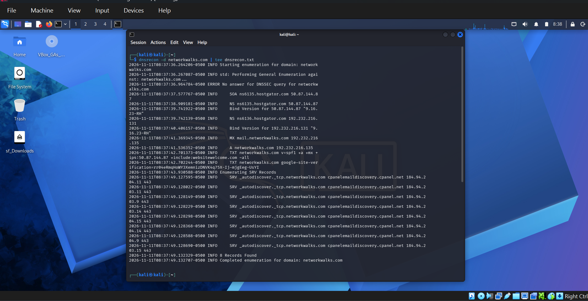
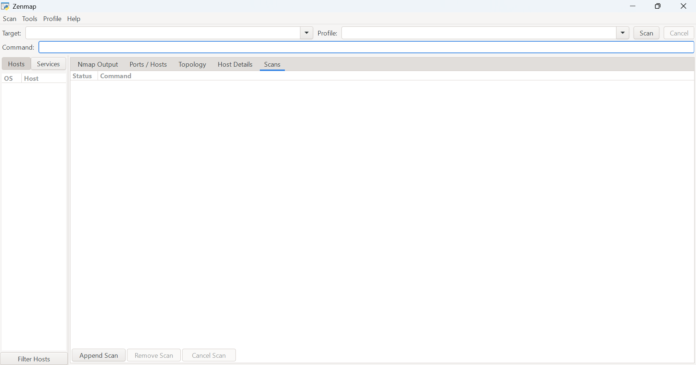
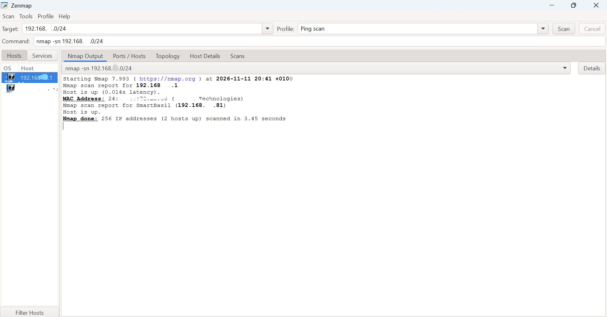
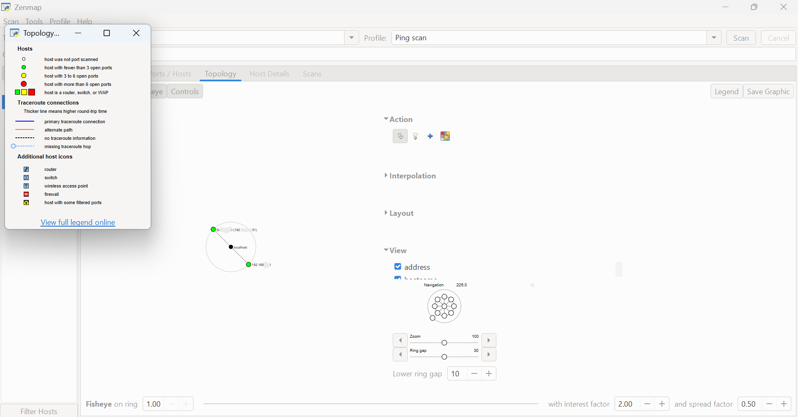
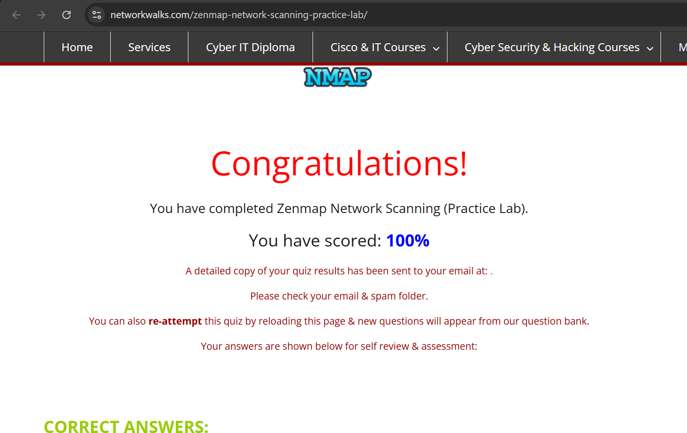

# SOC Internship: Week 2 Projects

Two Week 2 projects from the Networkwalks Cybersecurity & Ethical Hacking internship:

1. **W2-PM1:** Footprinting `networkwalks.com` with six Kali Linux tools
2. **W2-PM5:** Network scanning with Zenmap

The full write-up is in the report: [W2-PM-FINAL-Penetration-Testing-Report.docx](W2-PM-FINAL-Penetration-Testing-Report.docx)

---

## Part 1: Footprinting with Kali Linux (W2-PM1)

**Goal:** Collect public information about the target without touching its systems, using the tools built into Kali.

**Target:** networkwalks.com (the course's own lab site, used as instructed).

| # | Tool | Command | What it showed |
|---|---|---|---|
| 1 | whois | `whois networkwalks.com` | Registered with GoDaddy on 6 Nov 2019, name servers at HostGator, owner hidden by a privacy service, DNSSEC off |
| 2 | whatweb | `whatweb networkwalks.com` | Apache server running WordPress 7.1.4 with WordPress Download Manager 3.3.76 |
| 3 | nslookup | `nslookup networkwalks.com` | IP address `192.232.216.135` |
| 4 | curl | `curl -I https://networkwalks.com` | HTTP/2 200, Apache, exposes the WordPress API at `/wp-json/` |
| 5 | wafw00f | `wafw00f networkwalks.com` | Protected by ModSecurity (SpiderLabs) WAF |
| 6 | dnsrecon | `dnsrecon -d networkwalks.com` | Name servers, mail server, SPF record, 8 SRV records, BIND version 9.16.23-RH |

### Screenshots

**1. whois**


**2. whatweb**


**3. nslookup**


**4. curl**


**5. wafw00f**


**6. dnsrecon**


The saved text output of each tool is in the [`outputs`](outputs) folder.

---

## Part 2: Network Scanning with Zenmap (W2-PM5)

**Goal:** Find the live hosts on my own local network using Zenmap, the GUI for Nmap.

| Task | What I did |
|---|---|
| 1 | Installed Zenmap from the official Nmap website |
| 2 | Found my IP address and subnet with `ipconfig` |
| 3 | Ran a Ping scan (`nmap -sn`) on my local subnet |
| 4 | Counted the live hosts: **2** |
| 5 | Recorded the live hosts: my router and my own PC |
| 6 | Recorded the MAC address shown for the router |
| 7 | Saved the network topology as a PDF |

Parts of the addresses are hidden in the screenshots for privacy.

**Zenmap installed**


**Ping scan result**


**Network topology (with legend)**


### Lab result: 100%
I answered all the questions on the Zenmap practice lab and scored **100%**.



---

## What I Learned
- Recon tools can reveal a site's owner, hosting, software versions, firewall and DNS setup using only public information
- Exposed version numbers and DNS details help attackers plan, so they are worth reviewing
- A ping scan finds live devices on a network quickly, without scanning their ports

## Repository Contents
```
soc-internship-week2/
├── README.md
├── W2-PM-FINAL-Penetration-Testing-Report.docx
├── outputs/        (saved text output of the six Kali tools)
└── screenshots/    (evidence screenshots)
```

---

*For learning and authorised testing only. Footprinting was done on the course's lab target, and scans were run only on my own network.*
